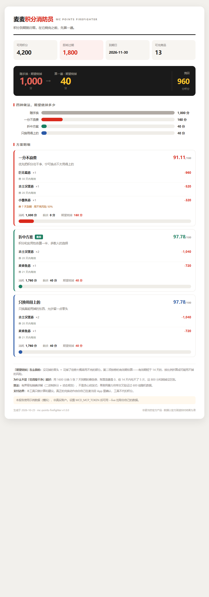

<div align="center">

# 🧯 麦麦积分消防员

**MC Points Firefighter**

麦当劳积分到期就归零——不是打折，是清零。
这个工具在它烧完之前，帮你算一遍。



</div>

---

## 这是一个真实存在的问题

打开麦当劳 App 的积分商城，大多数人是这样的：

1. 看到"即将过期 1800 分"，心里一紧
2. 随手换了一个看得顺眼的
3. 过了有效期，积分和券一起消失

问题出在哪？**积分商城的商品是整数价：320 分、520 分、960 分……
你的 1800 分几乎不可能正好凑整，剩下的零头一分不剩地烧掉。**
而换来的券自己也带有效期——你只是把火从左手挪到了右手。

这不是"推荐几个商品"的问题，这是一个**有界背包问题**：

> 在"每件商品限购 N 件、积分价固定、预算 = 即将过期积分"的约束下，
> 怎样组合才能让积分真正被用掉，而不是换成另一批会过期的券？

## 实测：随手换 vs 算一遍

用同一份账户数据（1800 分即将过期）：

| 做法 | 账面浪费 | 期望烧掉 |
|---|---:|---:|
| 随手换（换 5 张 7 天到期的薯条券） | 200 分 | **1000 分** |
| 一分不浪费策略 | 0 分 | 160 分 |
| **折中策略（推荐）** | 40 分 | **40 分** |

"期望烧掉"= 没花掉的零头 ＋ 花掉了但券大概率用不完的部分。
第二项是本项目最想指出的事：**花光积分不等于没浪费。**
账面 0 浪费的方案，可能把 800 分押在几张根本吃不完的短效期券上。

## 三行跑起来

```bash
git clone https://github.com/longyi-jim/mc-points-firefighter.git
cd mc-points-firefighter
python scripts/run.py            # 示例数据，立刻出报告
```

连自己的真实账号（需要免费的麦当劳 MCP Token）：

```bash
export MCD_MCP_TOKEN="你在 open.mcd.cn 复制的 Token"
python scripts/run.py --live
```

> Token 申请：打开 [open.mcd.cn/mcp](https://open.mcd.cn/mcp) → 手机号登录 → 控制台 → 激活。
> Token 只从环境变量读取，不落盘、不进日志、不进产物。

**依赖：Python 3.9+，零第三方依赖。** 不用 pip install 任何东西。

## 它是怎么算的

三种策略，同一个背包内核，不同的价值函数：

| 策略 | 目标 | 适合谁 |
|---|---|---|
| 🔴 一分不浪费 | 消耗积分最多 | "积分清零我难受"型 |
| 🟢 折中方案 | 积分消耗与实用性各半 | 多数人 |
| 🔵 只换用得上的 | 换到手的东西真能用掉 | "换成用不上的也是浪费"型 |

技术上三件值得一提的事：

- **精确解，不是启发式。** 二进制拆分 + 动态规划的有界背包，
  几千积分毫秒级出结果。单元测试用暴力穷举交叉验证了 600 组随机数据，全部一致。
- **二次浪费被写进了目标函数。** 券的有效期短于用券窗口（默认 14 天）时，
  它的单位效用按比例折减，DP 会自己避开短效期商品，而不是等方案出来再补救。
- **字段适配层是诚实的。** MCP 返回的字段名没有公开文档，适配层逐个候选键尝试，
  拿不到就给默认值并告诉你——而不是假装成功。第一次接真实账号时建议先 `--dump-raw` 核对。

## 用了哪些麦当劳 MCP 能力

| 工具 | 用途 |
|---|---|
| `query-my-account` | 拉可用 / 即将过期 / 累计积分 |
| `mall-points-products` | 拉商城商品池（积分价、有效期、限购、库存） |

详见 [MCP_INTEGRATION.md](MCP_INTEGRATION.md)。
真正的兑换（`mall-create-order`）**本工具默认不代执行**——
建议只算到方案为止，下单这个动作由你自己在 App 里确认。

## 适合谁

- 积分大户：常年几个积分账号，到期清零最心疼的那种
- 精打细算型：想知道"我这 3000 分到底能换什么最不亏"
- 开发者：想看一个把运筹学用在奶茶钱上的完整实现

## 项目结构

```
mc-points-firefighter/
├── README.md                  ← 你在这里
├── CONTEST_DECLARATION.md     ← 官方参赛声明（原样保留）
├── MCP_INTEGRATION.md         ← MCP 工具调用说明
├── SKILL.md                   ← Agent Skill 定义（WorkBuddy 可直接加载）
├── workbuddy.md               ← WorkBuddy 开发对话记录
├── scripts/
│   ├── optimize.py            ← 核心算法（三种策略 + 期望浪费指标）
│   ├── fetch_via_mcp.py       ← 纯标准库 MCP 客户端
│   ├── report.py              ← 单文件 HTML 报告卡生成器
│   └── run.py                 ← 一键跑通
├── tests/
│   └── test_optimizer.py      ← 14 个测试，含 600 组暴力穷举交叉验证
└── examples/
    ├── account_demo.json      ← 示例数据（模拟）
    └── report.html            ← 生成的报告卡
```

## 常见问题

**Q: 我不知道自己的积分什么时候过期？**
`query-my-account` 会返回即将过期的积分和日期。工具会在报告顶部直接展示。

**Q: 换了之后券用不完怎么办？**
这正是"期望烧掉"这个指标存在的原因。工具会把每个方案里短效期券的风险单独标出来，
最终推荐的是"期望损失最小"的方案，而不是"账面花光"的方案。

**Q: 能不能自动下单？**
技术上 `mall-create-order` 支持纯积分兑换下单。但这个工具把它关在"建议"这一步：
积分是你自己的资产，确认的动作必须由你完成。

**Q: 为什么不用贪心/推荐算法？**
贪心在这种"整数价 + 限购"场景下经常漏掉最优组合（比如 960+520+320 凑 1800，
贪心会先抓 1580）。背包 DP 在这个规模下毫秒级，没必要用近似解。

## License

MIT © 2026
